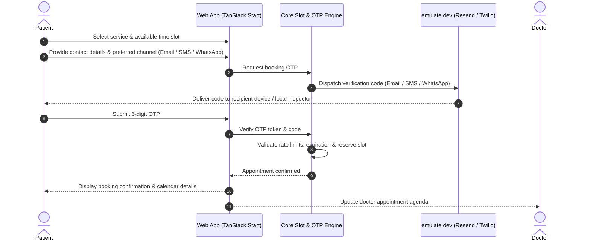

# appointment-booking-app

<p>
  <a href="LICENSE.md"></a>
  <a href="https://viteplus.dev"></a>
  <a href="https://tanstack.com/start"></a>
  <a href="https://emulate.dev"></a>
</p>

Modern, production-ready medical clinic appointment booking application with multi-channel OTP verification (Email, SMS, WhatsApp), dynamic doctor schedule engine, emergency triage screening, and zero-cost local API emulation powered by [`emulate`](https://github.com/vercel-labs/emulate).

## Quick Start

```bash
# 1. Install dependencies
pnpm install

# 2. Copy environment configuration
cp .env.example .env

# 3. Start local third-party API emulators (Resend & Twilio)
pnpm run emulate

# 4. In a separate terminal, start the development server
pnpm dev
```

All services start on local loopback (`127.0.0.1`) without requiring third-party cloud accounts or live API keys:

- **Web Application**: `http://localhost:3000`
- **Resend Email Emulator**: `http://localhost:4000` (Inspect emails at `http://localhost:4000/inbox`)
- **Twilio SMS & WhatsApp Emulator**: `http://localhost:4001` (Inspect messages at `http://localhost:4001/`)

## Key Features

- **Multi-Channel Passwordless Verification**:
  - One-time passcode (OTP) verification dispatched via **Email** ([Resend](https://resend.com)), **SMS**, or **WhatsApp** ([Twilio](https://twilio.com)).
  - Configurable code expiration (5 minutes), masked recipient preview, attempt rate limiting, and brute-force lockout protections.
- **Dynamic Calendar & Slot Availability Engine**:
  - Calculates bookable time slots based on doctor working hours, buffer windows between appointments, lunch breaks, and schedule overrides.
  - Concurrency-safe slot reservation preventing double-bookings and race conditions under simultaneous patient checkouts.
- **Local API Emulation ([emulate.dev](https://emulate.dev))**:
  - Full-fidelity local drop-in replacements for Resend and Twilio REST APIs.
  - No external network access or paid credentials required during local development or automated CI runs.
  - Visual inspector interfaces for verifying dispatched emails, SMS, and WhatsApp alerts in real time.
- **Patient & Clinic Experience**:
  - Emergency medical triage banner with instant crisis alerts.
  - Self-service booking management allowing patients to review and cancel upcoming visits in compliance with clinic cancellation policies.
  - Doctor schedule overview and day-by-day appointment agenda.
- **Edge-First Architecture**:
  - Built with **TanStack Start** (SSR, client hydration, type-safe RPC server functions, and file-based routing).
  - Designed for deployment on **Cloudflare Workers**.
  - Styled with **Tailwind CSS v4** and `@phosphor-icons/react`.
  - Type-safe data modeling and validation using TypeScript and Drizzle ORM.

## Local Emulation

This repository uses [`emulate`](https://github.com/vercel-labs/emulate) to run local mock-free emulators for external communications:

```bash
pnpm run emulate
```

This executes:

```bash
emulate start --service resend,twilio
```

### Emulated Services

| Service    | Emulated Port | Description                                              | Dev Webhook / Inspector       |
| ---------- | ------------- | -------------------------------------------------------- | ----------------------------- |
| **Resend** | `4000`        | Emulates transactional email delivery via `POST /emails` | `http://localhost:4000/inbox` |
| **Twilio** | `4001`        | Emulates Twilio REST Messages API for SMS and WhatsApp   | `http://localhost:4001/`      |

When running in development, notification requests sent from `apps/web/src/lib/notifications.ts` automatically target the local emulators. If `emulate` is not running, the application gracefully provides inline fallback codes in the development console so workflows are never blocked.

## Architecture & Monorepo Layout

The project is structured as a pnpm monorepo managed with **Vite+** (`vp`):

```text
appointment-booking-app/
├── apps/
│   └── web/                   # Full-stack TanStack Start application (Cloudflare Workers)
│       ├── src/
│       │   ├── routes/        # File-based routes (/, /book, /clinic, /patient)
│       │   ├── components/    # UI components (Header, Footer, Triage, Toast)
│       │   └── lib/           # Server functions, notifications, store
│       └── wrangler.jsonc     # Cloudflare Workers configuration
├── packages/
│   ├── config/                # Clinic profile, hours, contact info, and policies
│   ├── core/                  # Pure domain logic (slots, OTP verification, triage)
│   └── db/                    # Drizzle ORM schema, migrations, and seed data
├── .env.example               # Environment variables template
├── LICENSE.md                 # MIT License
├── package.json               # Root scripts and workspace catalogs
└── vite.config.ts             # Vite+ configuration
```

## CLI & Scripts

Built-in commands and package scripts are orchestrated via `vp` (Vite+) and `pnpm`:

| Command              | Toolchain          | Description                                                   |
| -------------------- | ------------------ | ------------------------------------------------------------- |
| `pnpm dev`           | `vp run web#dev`   | Start the local TanStack Start development server             |
| `pnpm run emulate`   | `emulate`          | Launch local Resend & Twilio API emulators                    |
| `pnpm test`          | `vp test`          | Run the Vitest test suite across all workspace packages       |
| `pnpm check`         | `vp check`         | Check formatting, linting, and TypeScript types               |
| `pnpm run check:fix` | `vp check --fix`   | Automatically fix formatting and lint issues                  |
| `pnpm run lint`      | `vp lint`          | Run Oxlint across the codebase                                |
| `pnpm run format`    | `vp fmt`           | Format all files with Oxfmt                                   |
| `pnpm run build`     | `vp run web#build` | Build the full-stack web application for production           |
| `pnpm run ready`     | `vp run ready`     | Run complete CI pre-flight check (`check` + `test` + `build`) |

## Configuration

Environment variables are configured in `.env` (copy from `.env.example`). The same code runs seamlessly in development (with `emulate`) and production:

```ini
# ==============================================================================
# Apex Wellness Clinic - Environment Configuration
# ==============================================================================

# Resend Email Configuration
RESEND_API_KEY=re_test_emulate_key
RESEND_BASE_URL=http://localhost:4000
RESEND_FROM_EMAIL="Apex Wellness Clinic <appointments@apexwellnessclinic.com>"

# Twilio SMS & WhatsApp Configuration
TWILIO_ACCOUNT_SID=AC00000000000000000000000000000000
TWILIO_AUTH_TOKEN=twilio_test_auth_token
TWILIO_PHONE_NUMBER=+15551234567
TWILIO_BASE_URL=http://localhost:4001
TWILIO_WHATSAPP_NUMBER=+15551234567
```

### Options Reference

| Variable                 | Dev Default             | Production Usage                                          |
| ------------------------ | ----------------------- | --------------------------------------------------------- |
| `RESEND_API_KEY`         | `re_test_emulate_key`   | Live API key generated from [Resend](https://resend.com)  |
| `RESEND_BASE_URL`        | `http://localhost:4000` | Omit in production (defaults to Resend cloud API)         |
| `RESEND_FROM_EMAIL`      | Clinic address          | Verified sender domain in Resend                          |
| `TWILIO_ACCOUNT_SID`     | `AC000...`              | Live Twilio Account SID from Twilio Console               |
| `TWILIO_AUTH_TOKEN`      | `twilio_test...`        | Live Twilio Auth Token                                    |
| `TWILIO_PHONE_NUMBER`    | `+15551234567`          | Active Twilio SMS-enabled phone number (E.164 format)     |
| `TWILIO_BASE_URL`        | `http://localhost:4001` | Omit in production (defaults to `https://api.twilio.com`) |
| `TWILIO_WHATSAPP_NUMBER` | `+15551234567`          | Approved Twilio WhatsApp sender number                    |

## Booking & Verification Flow



## Testing & Quality Assurance

All unit and integration tests are executed using Vitest through Vite+:

```bash
# Run all workspace tests
vp test

# Run tests in watch mode
vp test --watch
```

Automated test suites in `packages/core/tests` cover:

- **Concurrency & Double-Booking Prevention**: Race condition testing under simulated simultaneous booking requests.
- **OTP Lifecycle**: Generation, cryptographic expiration, channel formatting, and brute-force attempt limits.
- **Slot Engine**: Availability calculation, doctor break times, booking buffers, and schedule overrides.

To format, lint, and type check the entire repository:

```bash
vp check
```

## Deployment

The web application is optimized for deployment on Cloudflare Workers using the Cloudflare Vite plugin and Wrangler:

```bash
# 1. Install Wrangler CLI (if not already installed)
npm install -g wrangler

# 2. Authenticate with Cloudflare
wrangler login

# 3. Deploy to Cloudflare Workers
npx wrangler deploy
```

Configure production secrets using the Wrangler CLI:

```bash
wrangler secret put RESEND_API_KEY
wrangler secret put TWILIO_ACCOUNT_SID
wrangler secret put TWILIO_AUTH_TOKEN
```

## Acknowledgments

- [emulate](https://github.com/vercel-labs/emulate) by Vercel Labs for local API emulation.
- [Vite+](https://viteplus.dev) for the unified web development toolchain.
- [TanStack Start](https://tanstack.com/start) and [TanStack Router](https://tanstack.com/router) for full-stack routing and server functions.
- [Hono](https://hono.dev) and [Cloudflare Workers](https://workers.cloudflare.com/) for the edge runtime.

## License

This project is licensed under the MIT License - see the [`LICENSE.md`](LICENSE.md) file for details.
